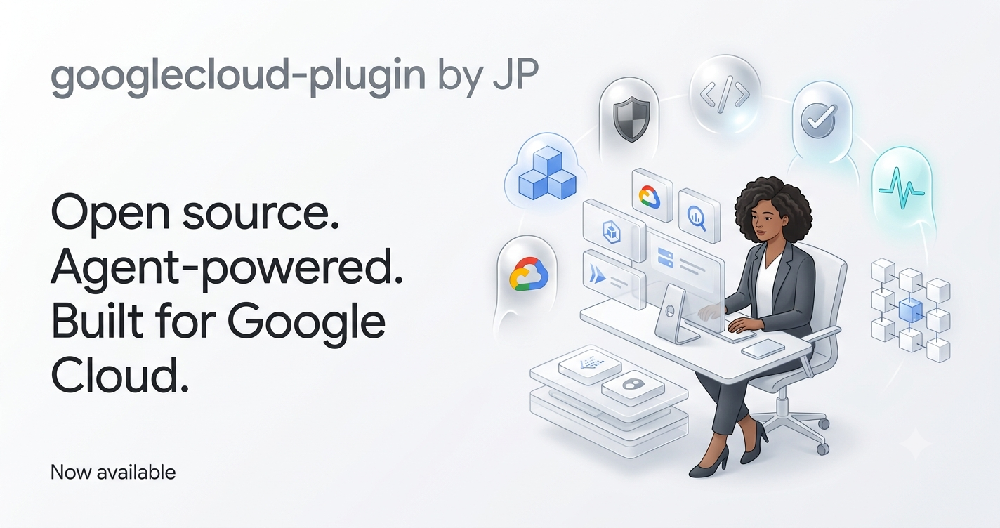
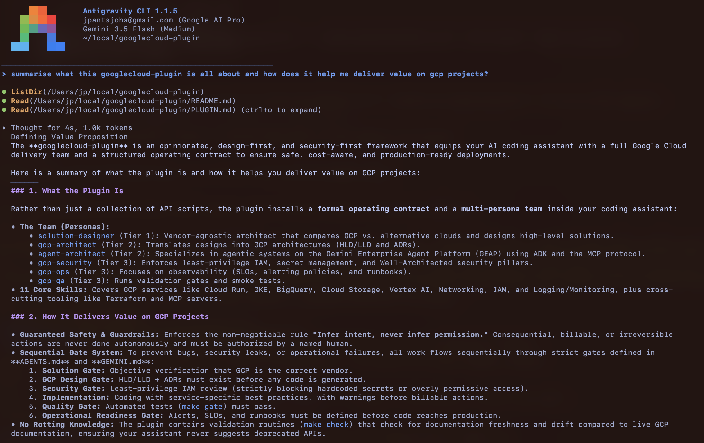
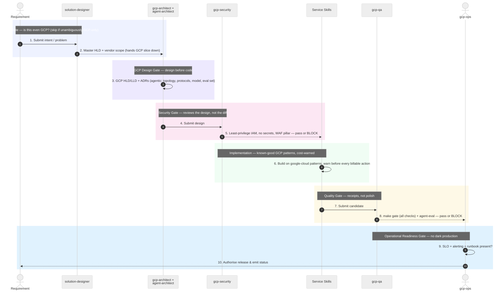

<p align="center">
  
</p>

[](https://www.claudepluginhub.com/plugins/jpantsjoha-googlecloud-plugin?ref=badge)
[](https://agent-plugins.org/specification)
[](https://agentskills.io/specification)

# GoogleCloud Plugin

> **Install once, and your coding agent gains a full Google Cloud delivery team — a vendor-objective solution designer, a GCP architect, an agentic-systems architect, plus security, SRE, and QA — wired into a design-first, security-first delivery gate.**

> **All the GCP skills. All the MCP servers available today. Assembled to fast-track the right architecture for your requirements.**

Skill libraries for Google Cloud are everywhere. What they miss is the operating contract: who designs before anyone writes code, who signs off on least-privilege before anything deploys, what "done" means when an agent ships to a billable cloud. This plugin ships that contract, with the GCP know-how built in.

One install gives an agent (Claude, Codex, Antigravity or Kimi) six personas, eleven service skills, three safety-and-depth skills, live Google documentation (wired for Claude Code, Antigravity and Gemini CLI), and a research pipeline that keeps every reference current. A plugin that goes stale in silence is worse than none.

**Compliant with [Agent Plugins 1.0.0](https://agent-plugins.org/specification)** — the open, vendor-neutral packaging standard co-maintained by Amazon, Cursor, Google, Microsoft, OpenAI and Vercel ([announcement](https://developers.googleblog.com/agent-plugins-package-your-skills-tools-and-more/)) — and with the [Agent Skills specification](https://agentskills.io/specification) it references. One directory layout works across conformant clients, rather than a bespoke wrapper per harness. Enforced in CI by `make spec` and verified against the official reference validator; see [Standards and compliance](#standards-and-compliance).

The plugin is **GCP-only and opinionated by design**. It covers the services a builder reaches for — Firebase, Cloud Run, BigQuery, GKE — and the agent frameworks now built on top: ADK, and the MCP / A2A / AP2 protocol stack, deployed on the Gemini Enterprise Agent Platform. Refine it for your team. Keep the contract coherent as you do.

> **Speed is easy. Safe speed is engineered.**

---

## Install

One plugin, four coding assistants. Skills live in `skills/`; each harness reads its own manifest.

**Claude Code**

```text
/plugin marketplace add jpantsjoha/googlecloud-plugin
/plugin install googlecloud-plugin@googlecloud-plugin-marketplace
```

**Antigravity (Gemini)**

```bash
agy plugin install https://github.com/jpantsjoha/googlecloud-plugin
```

**Kimi Code**

```text
/plugins install https://github.com/jpantsjoha/googlecloud-plugin
```

**Codex** — no install step. Codex discovers `.agents/skills/` natively and reads `AGENTS.md` as its always-on adapter. Clone the repo and Codex picks up the contract. `.codex-plugin/plugin.json` carries the display name, description and starter prompts Codex shows when the plugin is listed:

```bash
git clone https://github.com/jpantsjoha/googlecloud-plugin
```

After cloning to work on the plugin itself, install the pre-commit gate once:

```bash
make hooks    # runs `make gate` (validate + manifest + mermaid + lint + test) on every commit
```

---

## Quick start

**1. Log in once.** With a working gcloud login, no API key is needed.

```bash
gcloud auth application-default login
gcloud auth application-default set-quota-project PROJECT_ID   # bills docs-server calls to this project
```

The quota project needs the Developer Knowledge API enabled (an administrator task). Claude Code's docs connection also needs `python3`.

**2. Ask in plain language.** Most questions need no project at all:

| Ask | What happens |
| :--- | :--- |
| *"What does Google recommend for Cloud Run service-to-service auth? Check the docs."* | Answers from official Google documentation via the Developer Knowledge server, with sources. No target project needed. |
| *"Design a Cloud Run service for this app and take it through the security gate."* | Solution → GCP design → security gate, before any code. |
| *"Review my architecture against the Well-Architected Framework."* | Pillar-by-pillar gaps from `well-architected`, with deeper Google skills fetched on demand. |
| *"List the Cloud Run services in my project."* | Settles the project first (below), then runs `gcloud` with `--project`, one command at a time. |

**3. The project is settled only when a command needs one.** The plugin reads `CLOUDSDK_CORE_PROJECT`, `GOOGLE_CLOUD_PROJECT`, `GCP_PROJECT_ID`, `GCLOUD_PROJECT`, your repository's `.env` / `.env.local` (those keys only) and your active gcloud configuration:

- **one project** — it says which, and proceeds;
- **several** — it asks you to pick, and runs no project-scoped command until you do;
- **none** — it tells you to run `gcloud init`.

In Claude Code a hook enforces this for the `gcloud` MCP tool and shell commands: a project-scoped call without `--project` is stopped and the agent is told what the sources say. It needs `python3`; without it, or on input it cannot read, the call goes ahead. Other clients rely on the skill's instructions. Check your own setup with `python3 scripts/preflight.py` (exit 0 ready, 3 sources disagree, 2 project or credentials missing).

**4. Consequential commands wait for you.** `gcloud-guardrails` instructs the agent to show anything that creates, changes, deletes or bills, with its effect, and wait for your yes; IAM changes, deletes, billing, KMS and organization changes are never to run unattended. This is instruction, not a hook; your client's own permission prompts still apply.

---

The plugin running in Antigravity — asked what it is and how it delivers value, the agent introduces the team and the delivery gate:

<p align="center">
  
</p>

---

## The Solution → Delivery Workflow

Every piece of work flows through sequential gates. No gate opens until the one before it clears. Human intent enters at the top; a human authorises production at the bottom. The AI personas scale the execution in between — they never grant their own authority.



### Gate ownership

| Gate | Owner | Blocks release when |
| :--- | :--- | :--- |
| **Solution** | `solution-designer` | Vendor choice unclear, or GCP scope not delimited (skips if GCP-only) |
| **GCP Design** | `gcp-architect` (+ `agent-architect` if agentic) | No GCP HLD, or HLD contradicts the solution design |
| **Security** | `gcp-security` | IAM over-permissive, secrets in code, GCP risks unaddressed |
| **Quality** | `gcp-qa` (+ `agent-architect` agent-eval) | `make gate` fails, acceptance criteria unmet, agent eval fails |
| **Operational Readiness** | `gcp-ops` | No SLO, alerting, or runbook for a production workload |

The rule underneath every gate: **infer intent, never infer permission.** An AI persona drafts, designs, and validates; a named human authorises anything consequential, billable, or irreversible.

---

## What you install

**Six personas** — the team:

| Persona | Tier | Owns |
| :--- | :--- | :--- |
| `solution-designer` | 1 · vendor-agnostic | The overarching solution; objective vendor selection across GCP / AWS / Azure |
| `gcp-architect` | 2 · GCP | GCP infrastructure design — HLD/LLD, ADRs, IAM and network topology |
| `agent-architect` | 2 · GCP agentic | Agentic systems on GEAP — ADK, Agent Runtime, MCP/A2A/AP2, and agent evaluation |
| `gcp-security` | 3 | Least-privilege IAM, secrets, Well-Architected security pillar |
| `gcp-ops` | 3 | SLOs, alerting, runbooks, operational readiness |
| `gcp-qa` | 3 | Validation, linting, smoke tests, the quality gate |

**Eight first-wave service skills:** Cloud Run · GKE · IAM · BigQuery · Cloud Storage · Vertex AI · Networking · Logging/Monitoring.

**Three cross-cutting skills:** `mcp-servers` (Google-managed + self-hosted MCP setup) · `well-architected` (the six-pillar framework) · `terraform-gcp` (CFT + provider patterns).

**Three safety-and-depth skills:**

| Skill | Does |
| :--- | :--- |
| `gcloud-guardrails` | Every `gcloud` call: syntax checked with `gcloud help`, dry run first where supported, output trimmed, one command at a time, consequential commands held for your approval. |
| `gcp-project-context` | Works out which project a command targets from env, `.env` and gcloud config; asks when they disagree. Skipped for docs, design and review work. |
| `google-skills-catalog` | Fetches the matching skill from Google's public catalog (180+ product skills) when a question needs more depth than this plugin carries. HTTPS only, Google's repository only. |

**MCP servers and hooks:**

| Component | Status | Notes |
| :--- | :--- | :--- |
| `gcloud` (local, `@google-cloud/gcloud-mcp`) | shipped | Inherits your project the way `gcloud` does. |
| `developer-knowledge` (Google, remote) | shipped (Claude Code, Antigravity, Gemini CLI) | Official Google Cloud, Firebase, Android and Gemini docs. Claude Code authenticates from your gcloud login; Antigravity and Gemini CLI use their own Google sign-in. Codex and Kimi: add it to your own MCP config (see `mcp-servers`). |
| Project guard hook (Claude Code) | shipped | Stops project-scoped `gcloud` calls (MCP tool and shell) without `--project`; asks on conflict. Needs `python3` and lets the call through without it. Checks the project only, not the location. |
| GenAI Toolbox, remote Cloud CLI MCP | opt-in | Need a `tools.yaml`, or an enabled API and IAM grant; setup in `mcp-servers`. |

---

## How it compares with Google's plugin

Google announced [`google-cloud-developer`](https://cloud.google.com/blog/topics/developers-practitioners/google-cloud-developer-plugin-now-available-in-antigravity-marketplace) on 3 November 2026; the comparison below is against its repository as read on 9 November 2026 (v1.1.17). The two are complementary: Google's bundles a small set of skills and fetches the rest; this plugin adds delivery roles and gates on top. Parts of Google's work are adapted here under Apache-2.0 (see `NOTICE`).

| | Google `google-cloud-developer` | This plugin |
| :--- | :--- | :--- |
| **Purpose** | Onboarding, auth guidance, safe `gcloud`, docs grounding | The same, plus a design → security → quality → operations delivery gate |
| **Skills** | 5 (`gcloud`, auth and onboarding recipes, docs retrieval, catalog finder) | 20: six personas, eleven service skills, three safety-and-depth skills |
| **Product depth** | Fetches Google's catalog on demand | Its own service skills, plus the same catalog on demand |
| **`gcloud` safety** | Leaf `gcloud help`, dry run, trimmed output, denylist | Same rules, adapted; plus approval asked for every consequential command |
| **Project selection** | Explicit `--project` and location required | Same rule; plus reconciling env, `.env` and gcloud config, asking on conflict, and a Claude Code hook that enforces explicit project selection (not location) |
| **Docs MCP auth** | Google sign-in in Antigravity and Gemini CLI; API key in Claude Code | Google sign-in in Claude Code, Antigravity and Gemini CLI — no key |
| **Clients** | Antigravity Marketplace listing; manifests for Antigravity, Claude, Codex, Gemini | Manifests for Claude Code, Antigravity, Codex, Kimi, Gemini CLI |
| **Packaging** | Agent Plugins manifest with extra display fields | Agent Plugins 1.0.0 conformant; validated in CI |
| **Licence** | Apache-2.0 | MIT |

Choose Google's for a small bundled skill set. Choose this one when you also want delivery roles, gate guidance and project-selection enforcement.

---

## Troubleshooting

**`gcloud` MCP server shows as failed straight after install or update (Claude Code).** Seen in Claude Code 2.1.323: the first session after installing or updating the plugin failed to connect, and Claude Code then skips the server for 15 minutes ("recent failure cached, retries automatically in 15 min"). It is not a slow download — a cold `npx` start answered in 2.8 seconds against a 30-second limit — and the cause is not yet known. Wait out the 15 minutes, or reconnect the server from `/mcp` in an interactive session. Meanwhile the agent can run `gcloud` in the shell; the project guard applies there too.

**Docs server returns `403`.** Set a quota project (`gcloud auth application-default set-quota-project PROJECT_ID`) with the Developer Knowledge API enabled; see `mcp-servers`.

**A command was blocked by the project guard.** The message says why: add `--project`, or answer which project to use. To check what the plugin sees, run `python3 scripts/preflight.py`.

---

## Standards and compliance

This plugin conforms to the open, vendor-neutral packaging standards — not to any
single vendor's plugin format.

| Standard | Version | What conforms | How it's verified |
|---|---|---|---|
| [Agent Plugins](https://agent-plugins.org/specification) | 1.0.0 | `plugin.json`, `mcp.json`, the `skills/` layout | `make spec` + [`plugin.schema.json`](https://agent-plugins.org/schemas/1.0.0/plugin.schema.json) / [`mcp.schema.json`](https://agent-plugins.org/schemas/1.0.0/mcp.schema.json) |
| [Agent Skills](https://agentskills.io/specification) | current | all 20 `SKILL.md` files | `make validate` + the official [`skills-ref`](https://github.com/agentskills/agentskills/tree/main/skills-ref) reference validator |
| [Model Context Protocol](https://modelcontextprotocol.io) | stdio + streamable HTTP | `mcp.json` and harness manifests | `make spec` transport + placeholder checks; `make manifest` endpoint drift guard |

Agent Plugins 1.0.0 is co-maintained by Amazon, Cursor, Google, Microsoft, OpenAI
and Vercel. Conforming to it means one directory layout works across conformant
clients instead of a bespoke wrapper per harness. The per-harness manifests
(`.claude-plugin/`, `.kimi-plugin/`, `gemini-extension.json`, `.agents/`) remain
alongside it, so existing installs are unaffected.

Verify it yourself, without trusting this repo's own scripts:

```bash
uvx --from "git+https://github.com/agentskills/agentskills.git#subdirectory=skills-ref" \
    skills-ref validate skills/cloud-run
uvx check-jsonschema --schemafile https://agent-plugins.org/schemas/1.0.0/plugin.schema.json plugin.json
```

See [ADR-007](architecture/decisions/ADR-007-agent-plugins-conformance.md) for the
adoption decision and its trade-offs.

---

## Validation

The plugin validates itself. Every skill conforms to a machine-readable contract; every reference URL is checked live; every source carries a retrieval date and content hash for audit.

```bash
make gate       # the full gate: spec + validate + manifest + mermaid + lint + test
make spec       # Agent Plugins 1.0.0 conformance (plugin.json + mcp.json + skills/)
make validate   # SKILL.md frontmatter vs the Agent Skills specification
make manifest   # per-harness manifests present and consistent
make lint       # every reference URL resolves (HTTP 200)
make test       # skill smoke tests
make check      # freshness: content-hash drift vs live GCP docs
make crawl      # refresh the research corpus (weekly)
```

Freshness is a feature, not a chore: `make check` runs weekly and flags any GCP doc that has drifted since it was last captured, so the plugin never quietly rots.

---

## About the author

Created and maintained by **Jaroslav Pantsjoha (JP)** — Technical Director and Enterprise Agent Solution Architect at Cognizant, Google Developer Expert (Google Cloud), speaker, and author of *Building the Agentic Enterprise on Google Cloud* (Packt).

I built this to make my own Google Cloud work repeatable, then to share it. The model is the easy part; the durable engineering is the harness around it — the skills, rules, MCP servers, gates, and evals. GCP patterns outlast the week's model release, so they are worth encoding once and reusing. This plugin is that baseline aimed squarely at Google Cloud — the GCP companion to my [DevEx Charter](https://github.com/jpantsjoha/ai-native-developer-experience) harness. Part of the **#HarnessEngineering** body of work — the engineering discipline behind the Agentic Enterprise.

- LinkedIn: [uk.linkedin.com/in/johas](https://uk.linkedin.com/in/johas)
- Google Developer Expert: [me.developers.google.com/u/jpantsjoha](https://me.developers.google.com/u/jpantsjoha)

---

## Licence

Open source under the [MIT License](LICENSE) — free for personal and commercial use, modification, and redistribution.

---

*This is an independent, community project. It is not affiliated with, sponsored by, or endorsed by Google LLC. "Google Cloud", "GCP", "Gemini", "Vertex AI", and related names are trademarks of Google LLC, used here only to describe what the plugin works with.*
